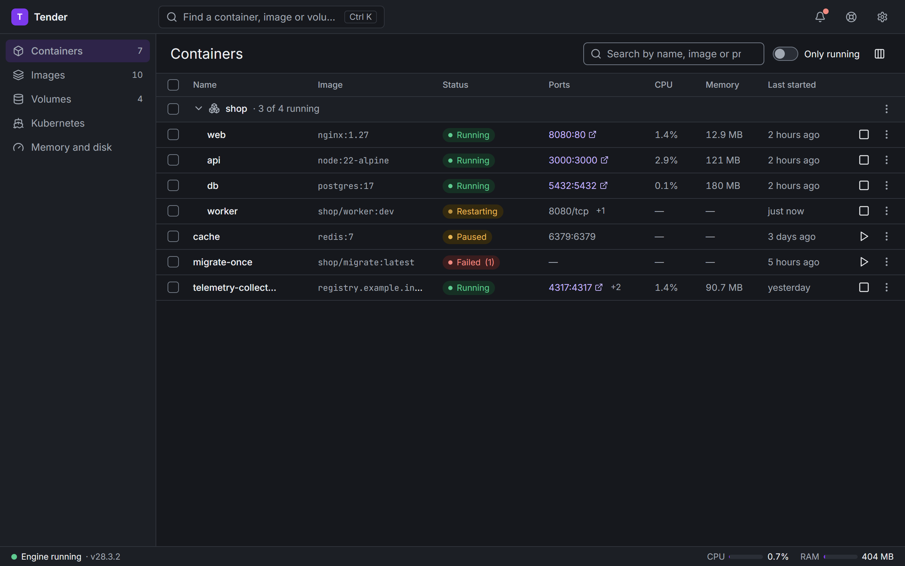
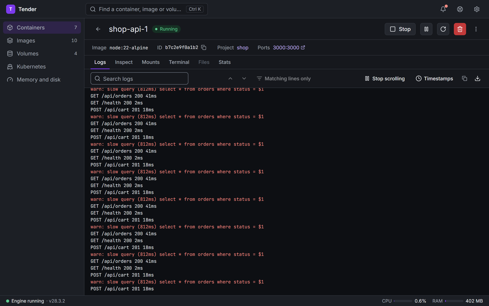
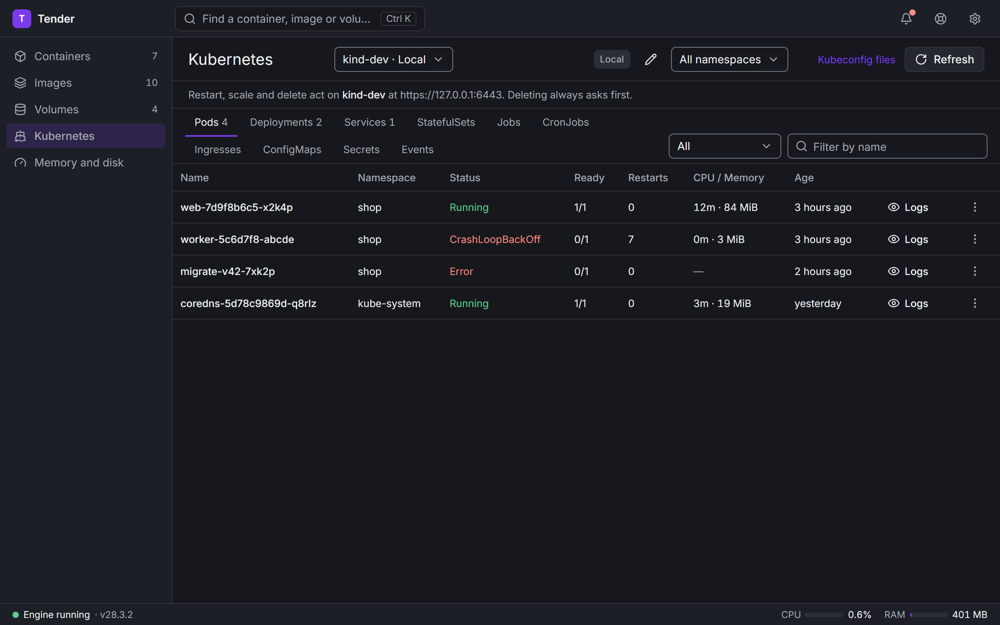
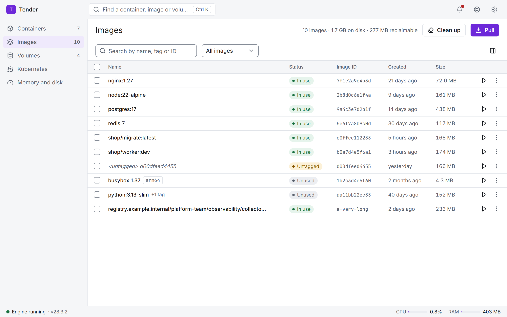
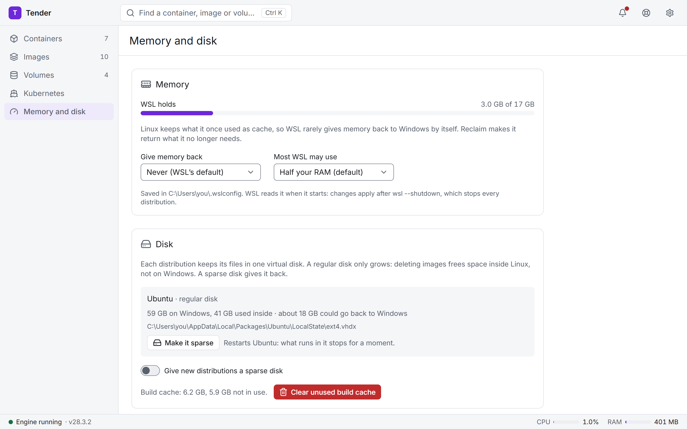
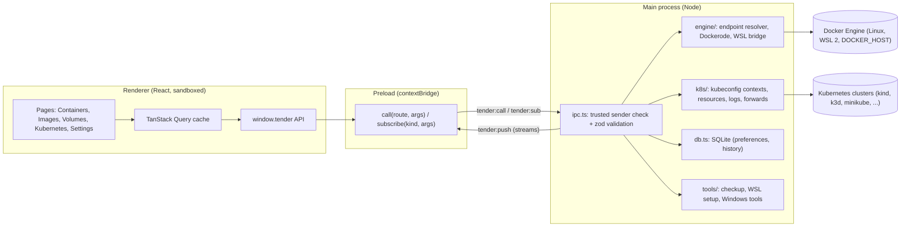
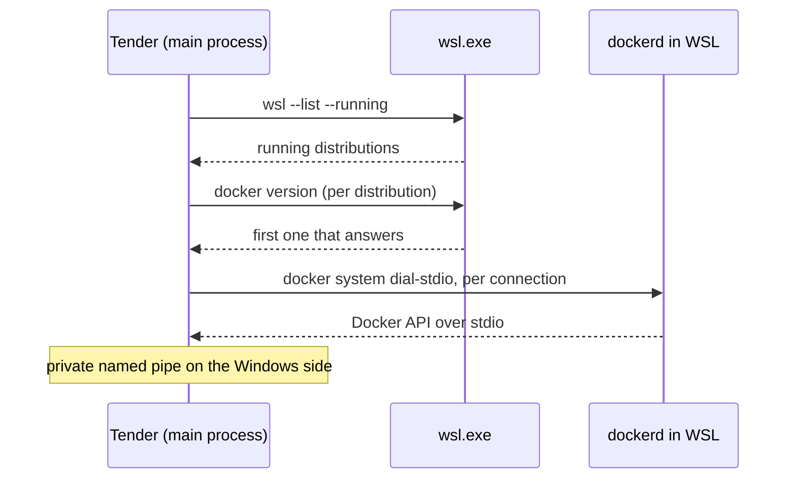

# Tender

*Language:* **English** | [Português (pt-BR)](README.pt-BR.md)


Tender is a desktop application for managing Docker environments through a focused graphical interface. It brings container workflows, image management, named volumes, live logs, resource statistics, an interactive terminal and a Kubernetes view into one place.

Tender does not replace the Docker Engine or the Docker CLI. It connects to the Docker Engine you already run (on Linux, inside WSL 2, or remotely) and gives you a visual way to inspect and operate it, with no licence, no VM of its own and no sign-in.

Tender runs on **Windows** and **Linux**. macOS builds from source.



<table>
  <tr>
    <td></td>
    <td></td>
  </tr>
  <tr>
    <td></td>
    <td></td>
  </tr>
</table>

<sub>Screenshots use the built-in sample data (`npm run shots` in `app/` takes them again).</sub>

---

## Architecture & System Overview

* **Problem:** on Windows, the usual way to get a Docker GUI is Docker Desktop, which brings its own VM, a licence for larger companies and an account. Many developers already run Docker Engine inside WSL 2 and only want a window onto it.
* **Solution:** an Electron app whose main process talks to the existing engine through Dockerode (and to Kubernetes clusters through `@kubernetes/client-node`). On Windows it bridges to an engine inside a running WSL distribution with `docker system dial-stdio`, and it can serve the standard `//./pipe/docker_engine` pipe so `docker.exe`, IDEs and Testcontainers work too. The renderer only sees a typed, validated IPC API.



Docker objects stay in the Docker Engine. Tender's SQLite database stores application state and preferences only; it never duplicates container or image data.

---

## Install

Download the latest build from [Releases](https://github.com/jluispbraga/Tender/releases):

| Platform | File |
| :--- | :--- |
| Windows | `Tender-Setup-<version>.exe` (installer) or `Tender-<version>-portable.exe` |
| Linux | `Tender-<version>-x86_64.AppImage` (any distribution) or `tender_<version>_amd64.deb` (Debian, Ubuntu) |

The builds are not code-signed yet, so on first run Windows SmartScreen shows "Windows protected your PC". Choose **More info**, then **Run anyway**. To check that the file is the one GitHub Actions built, compare its hash with `SHA256SUMS.txt` in the same release:

```powershell
Get-FileHash .\Tender-Setup-<version>.exe -Algorithm SHA256
```

On Linux, make the AppImage executable first: `chmod +x Tender-*.AppImage`.

---

## Features

### Containers
- Browse containers and inspect their configuration.
- Start, stop, restart, pause, unpause, and remove containers.
- Follow container logs in real time, search them, show only matching lines, stop scrolling, and save them to a file.
- View resource statistics: CPU, memory, network, block I/O, and process counts.
- Open an interactive terminal session inside a container.
- Inspect ports, mounts, environment variables, labels, and container details.
- Group and operate Docker Compose projects.

### Images
- Browse and inspect local images, tags, layers, and metadata.
- Pull images from a registry with layer-level progress and cancellation.
- Create containers from images, with port mappings, volume mounts, and environment variables.
- See which images are in use, unused, or dangling.
- Remove images and prune dangling or unused images, with the reclaimable disk space shown first.

### Volumes
- List and inspect named volumes and their container usage.
- Create and remove volumes.
- See which containers use a volume before deleting it.

### Beyond Docker Desktop
- **Kubernetes:** pods, deployments, services, StatefulSets, jobs, CronJobs, ingresses, ConfigMaps and secrets (key names only) for every context in your kubeconfig (kind, k3d, minikube, any cluster kubectl reaches). Filter by name or show only what is down, the namespace's events, CPU and memory per pod (with metrics-server), view any resource's YAML, rollout history with rollback, live logs you can search and save (a pod's, a job's, or all pods of a deployment at once), pod details and events, a terminal in a pod, and port forwards that come back when Tender opens. Restart or scale a deployment or StatefulSet, run or pause a CronJob, delete anything; deletes always ask first and name the context, and production clusters ask before every change.
- **Debug shell:** a BusyBox shell that joins a running container's processes and network, for images with no shell of their own (distroless, scratch). The container is not changed.
- **Checkup:** WSL, the engine, DNS and Windows tools checked in one place, each problem with its fix.
- **Memory and disk (Windows):** what WSL holds, memory reclaim and a cap, sparse virtual disks that give space back, build cache.

### Desktop experience
- Light, dark, and system theme options.
- System-tray integration and configurable startup behaviour.
- Persistent preferences, recent items, notifications, and table-column visibility.
- Engine connection status, a reconnect action, and troubleshooting guidance.
- Update checks against GitHub Releases.

---

## Technology Stack

| Component / Layer | Technology | Role in Architecture |
| :--- | :--- | :--- |
| Desktop runtime | Electron 44, electron-vite | Window, tray, IPC, packaging (electron-builder) |
| Frontend | React 18, TypeScript 5.8, Vite 6 | Renderer UI, lazy-loaded pages |
| UI and styling | Tailwind CSS 4, Radix UI, Lucide, cmdk | Design system, dialogs, menus, command palette |
| Data fetching and tables | TanStack Query, TanStack Table | Cache, polling, sortable and filterable grids |
| Docker integration | Dockerode | Containers, images, volumes, logs, stats, exec |
| Kubernetes integration | `@kubernetes/client-node` 2 | Contexts, resources, logs, exec, port forwards, metrics |
| Local persistence | SQLite (`node:sqlite`) | Preferences, endpoints, notifications, history |
| Validation | Zod | Every IPC argument and every setting value |
| Terminal | xterm.js | Container and pod shells |
| Charts | uPlot | Live resource statistics |
| Updates | electron-updater | Update checks against GitHub Releases |
| Tests | Vitest, Playwright, axe-core | Unit, integration, browser and Electron end-to-end, accessibility |
| CI | GitHub Actions, kind | Typecheck, tests, a real cluster, release builds |

---

## Project Structure

```text
Tender/
├── .github/workflows/
│   ├── ci.yml                    # Typecheck, unit tests and Playwright suite on every push and PR
│   ├── kube.yml                  # Kubernetes integration tests against a kind cluster
│   └── release.yml               # Windows and Linux builds for v* tags, attached to a draft release
├── docs/
│   ├── migrate-from-docker-desktop.md   # Moving containers, images and volumes off Docker Desktop
│   └── screenshots/              # README images (npm run shots)
├── tools/
│   └── migrate-from-docker-desktop.ps1  # Command-line version of the migration
├── LICENSE
└── app/                          # The Electron application
    ├── .env.example              # Optional environment variables
    ├── e2e/                      # Browser end-to-end tests (fake engine)
    │   └── kube/fixture.yaml     # Kubernetes objects the kind CI cluster starts with
    ├── e2e-electron/             # Electron tests against a real engine
    ├── resources/                # App and tray icons, installer script
    ├── scripts/                  # Smoke scripts (TENDER_SMOKE) and the unit test runner
    └── src/
        ├── main/                 # Electron main process
        │   ├── index.ts          # App lifecycle, window, tray, startup
        │   ├── ipc.ts            # Route table: trusted sender + zod validation
        │   ├── db.ts             # SQLite store and migrations
        │   ├── migrations/       # SQL migrations (0001_init.sql, ...)
        │   ├── engine/           # Endpoint resolver, Dockerode wrapper, WSL bridge
        │   ├── k8s/              # Kubernetes: overview, resources, logs, exec, forwards
        │   ├── migrate/          # Move from Docker Desktop
        │   └── tools/            # Checkup, WSL setup, .wslconfig, Windows Docker tools
        ├── preload/
        │   └── index.ts          # window.tender: the typed API over IPC
        └── renderer/src/
            ├── api/              # TenderApi types and the fake engine
            ├── app/              # App shell, routing, lazy pages
            ├── components/       # Reusable UI (log viewer, tables, charts, dialogs)
            └── pages/            # containers, images, volumes, kubernetes, settings, ...
```

---

## Key Features & Code Examples

### One IPC entry point, validated

The renderer never gets Node or `ipcRenderer`. It calls named routes through the preload, and the main process checks the sender and validates the arguments with zod before running anything (`app/src/main/ipc.ts`):

```ts
ipcMain.handle('tender:call', async (e, route: unknown, args: unknown) => {
  if (!deps.isTrustedSender(e)) return { ok: false, error: { message: 'Untrusted sender' } }
  const r = typeof route === 'string' ? routes[route] : undefined
  if (!r) return { ok: false, error: { message: `Unknown route ${String(route)}` } }
  const parsed = r.args.safeParse(args)
  if (!parsed.success) return { ok: false, error: { message: parsed.error.issues.map((i) => i.message).join('; '), status: 400 } }
  try {
    return { ok: true, value: await r.run(parsed.data) }
  } catch (err) {
    // ...turned into { ok: false, error: { message, status } }
  }
})
```

On the other side, the preload turns each route into a plain async function (`app/src/preload/index.ts`):

```ts
async function call<T>(route: string, ...args: unknown[]): Promise<T> {
  const r = (await ipcRenderer.invoke('tender:call', route, args)) as Envelope<T>
  if (!r.ok) throw apiError(r.error.message, r.error.status)
  return r.value
}
```

Streams (logs, stats, pulls, terminals, Kubernetes logs) use `tender:sub` / `tender:push` / `tender:unsub` with a subscription id, so the renderer can stop any stream it started.

### Same UI, two engines

`window.tender` implements `TenderApi` (`app/src/renderer/src/api/types.ts`). In `npm run dev:design` and in the browser test suite the renderer uses a deterministic fake engine instead, so every screen can be developed and tested without a Docker Engine. Production builds replace the fake with a stub (`electron.vite.config.ts`), so it never ships.

---

## Data Model

The Docker Engine is the source of truth for containers, images and volumes. The SQLite file (`app/src/main/migrations`) holds only what the engine does not:

| Table | Purpose |
| :--- | :--- |
| `engine_endpoints` | Engines Tender can talk to (`npipe`, `tcp`, `ssh`), with optional TLS paths and one default |
| `settings` | Typed key/value preferences, JSON values validated with zod before writing (theme, startup, `kube_forwards`, ...) |
| `grid_preferences` | Column visibility and sorting per table |
| `sidebar_items` | Sidebar order and visibility |
| `notifications` | In-app notifications |
| `pull_history` | Images pulled before, for quick re-pulls |
| `recent_searches` | Recent search terms |

---

## Getting Started

### Prerequisites

- Node.js that matches Electron 44 (Node 22 or later) and npm.
- A running Docker Engine and permission to use it. Tender never installs, starts or reconfigures the engine on its own.

| Where the engine runs | What to do |
| :--- | :--- |
| Linux (system service) | Nothing, as long as your user is in the `docker` group. |
| Linux (rootless Docker) | Nothing: Tender finds `$XDG_RUNTIME_DIR/docker.sock`. |
| Windows, Docker Engine installed inside WSL 2 | Nothing: keep the distribution running and Tender bridges to it (see below). |
| Windows, WSL 2 without Docker yet | **Set up Docker in WSL** in Tender installs Docker Engine in a Debian or Ubuntu distribution, following Docker's own instructions: systemd, Docker's apt repository, your user in the `docker` group. |
| Windows, Docker Desktop or dockerd as a service | Nothing: Tender uses the default named pipe. |
| Another machine | Set `DOCKER_HOST` (for example `ssh://user@host`) or a Docker context. |

### Installation & Environment Setup

```bash
git clone https://github.com/jluispbraga/Tender.git
cd Tender/app
npm install
```

All environment variables are optional; `app/.env.example` lists them.

| Variable | Purpose |
| :--- | :--- |
| `DOCKER_HOST` | Explicit Docker Engine endpoint. |
| `DOCKER_CONTEXT` | Docker context name to use when `DOCKER_HOST` is not set. |
| `DOCKER_TLS_VERIFY` | Set to `1` to enable TLS verification for TCP connections. |
| `DOCKER_CERT_PATH` | Directory containing `ca.pem`, `cert.pem`, and `key.pem` for TLS. |
| `TENDER_DB_PATH` | Custom path for Tender's SQLite database. Defaults to `%APPDATA%\tender\tender.db` on Windows and `~/.config/tender/tender.db` on Linux. |
| `TENDER_SMOKE` | Development only: a script run against `window.tender` before the app exits. |
| `TENDER_SHOTS` | Development only: output directory for route screenshots taken by smoke runs. |
| `TENDER_SHOT_ROUTES` | Development only: comma-separated route hashes to capture during a smoke run. |

Example for a TCP endpoint (PowerShell):

```powershell
$env:DOCKER_HOST = "tcp://127.0.0.1:2375"
npm run dev
```

Only expose an unauthenticated Docker TCP endpoint on a trusted local machine: access to a Docker Engine gives powerful control over the host. For an engine inside WSL you do not need TCP at all.

### Running Locally

Run the desktop application in development mode (Docker features need a reachable engine):

```bash
npm run dev
```

Run only the renderer in a browser at `http://localhost:5174`, backed by the fake engine (it does not touch the host's real Docker resources):

```bash
npm run dev:design
```

### Running Tests

All commands run from `app/`.

```bash
npm run typecheck
```

```bash
npm run test:unit
```

```bash
npx playwright test --config playwright.config.ts
```

- `test:unit` runs Vitest on Electron's own Node, so `node:sqlite` matches the app.
- The Playwright browser suite starts the renderer in design mode with the fake engine, and also runs axe accessibility checks.
- Kubernetes integration tests (`src/main/k8s/kube.it.test.ts`) run against a real cluster when `TENDER_KUBE_IT` names a kubeconfig context and `e2e/kube/fixture.yaml` has been applied. CI does this on kind.

The Electron suite exercises the app against a real engine, so run it only where test operations are safe:

```bash
npx playwright test --config playwright.electron.config.ts
```

### Build & Release

```bash
npm run build
```

`build` runs the TypeScript checks and then builds the Electron app. To package it for the current platform (output in `app/release`):

```bash
npm run dist
```

`npm run dist:win` builds the Windows installer and portable exe; `npm run dist:linux` builds the AppImage and `.deb` and must run on Linux. Pushing a `v*` tag runs `.github/workflows/release.yml`, which builds both on GitHub Actions and attaches them to a draft release.

To preview the built app:

```bash
npm run start
```

---

## Docker Connection

Tender resolves the Docker endpoint in this order (`app/src/main/engine/endpoint.ts`):

1. `DOCKER_HOST`, when set.
2. `DOCKER_CONTEXT`, or the current Docker context in `~/.docker/config.json`.
3. The platform's default local endpoint:
   - **Linux:** `/var/run/docker.sock`, then rootless `$XDG_RUNTIME_DIR/docker.sock`, then Docker Desktop for Linux.
   - **macOS:** Docker Desktop, `/var/run/docker.sock`, Colima, OrbStack, Rancher Desktop.
   - **Windows:** the named pipe `npipe:////./pipe/docker_engine`.
4. **Windows only:** if that pipe does not exist, a Docker Engine inside a running WSL distribution.

The resolver reads Docker's existing context configuration; it never modifies it.

### Docker Engine inside WSL (Windows)

If you installed Docker Engine straight into a WSL distribution (no Docker Desktop), Windows programs cannot open its Unix socket. Tender bridges it for you:



- It looks only at distributions that are **already running**, so it never boots one.
- It uses the first one where `docker version` answers.
- Every connection goes through `docker system dial-stdio` inside that distribution, the same relay the Docker CLI uses over SSH, behind a private named pipe on the Windows side.

There is no TCP port, no root and no change to the distribution. You do not need to set `DOCKER_HOST`; if you set one, it still wins.

**Moving away from Docker Desktop?** Your existing containers, images and volumes live inside Docker Desktop's engine. Tender moves them to the engine inside WSL: the installer offers it when it finds Docker Desktop, and the **Move from Docker Desktop** page is always in Settings. [docs/migrate-from-docker-desktop.md](docs/migrate-from-docker-desktop.md) explains it, and also covers a command-line script.

**Docker tools on Windows.** While Tender runs, it serves the standard pipe `//./pipe/docker_engine` from the engine inside WSL, unless Docker Desktop already serves it. With that pipe, `docker.exe`, the VS Code Docker extension, Testcontainers and JetBrains IDEs work without Docker Desktop. Settings › Docker on Windows can also install the official Docker CLI, Compose and Buildx for your user, with no admin rights; Compose and Buildx are checked against the SHA-256 that GitHub records for each release file. Keep Tender in the notification area and start it at sign-in, so the pipe is always there.

If your user is not in the distribution's `docker` group, the connection error says so. Fix it with `sudo usermod -aG docker $USER` inside WSL, then `wsl --terminate <distro>` and start the distribution again.

---

## Technical Highlights & Engineering Decisions

* **Hardened renderer:** context isolation and the sandbox are on and Node integration is off. IPC requests are accepted only from the app's own window, and every argument is validated with zod. Tender requests no browser permissions (camera, microphone, notifications).
* **No new daemon, no VM:** Tender uses the engine you already have. The WSL bridge reuses `docker system dial-stdio` instead of opening a TCP port or changing the distribution.
* **Secrets stay secret:** for Kubernetes Secrets, Tender lists key names and sizes only; YAML views replace values with `(hidden)` and drop `last-applied-configuration`. An integration test checks that neither the value nor its base64 ever leaves the main process.
* **Safe by default on clusters:** deletes always ask and name the context; contexts marked as production ask before every change.
* **Fast start:** pages are lazy-loaded and preloaded after the first paint, and xterm.js loads only when a terminal opens.
* **Testable without Docker:** the fake engine drives the full UI in a browser, so the Playwright suite runs on any CI runner. A separate workflow runs the Kubernetes integration tests on a real kind cluster.
* **Docker access is privileged:** connect only to endpoints you trust, and protect any remote endpoint.

---

## Contributing

Contributions, bug reports, and suggestions are welcome. Before opening a pull request:

1. Install dependencies with `npm install` in `app/`.
2. Run `npm run build` to check types and build the application.
3. Run `npm run test:unit` and the relevant Playwright tests.
4. Include clear reproduction steps for bug fixes, and screenshots for UI changes when useful.

---

## License

Tender is released under the [MIT License](LICENSE).
