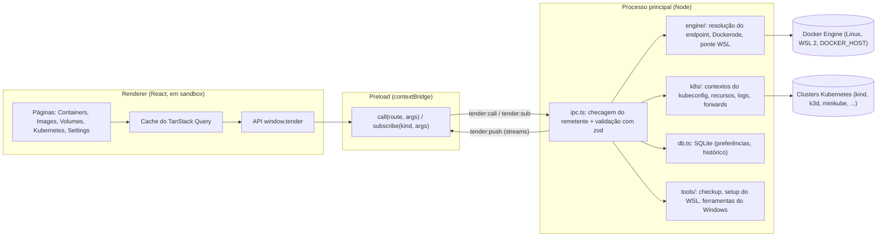
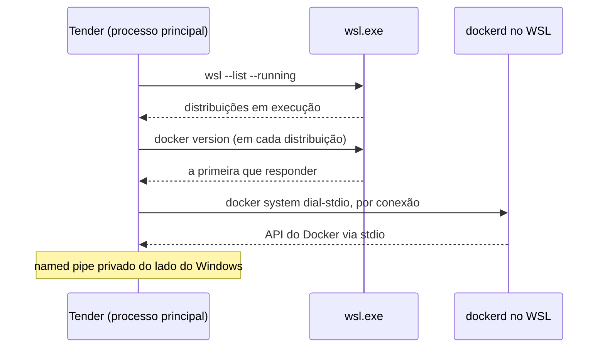

# Tender

*Idioma:* [English](README.md) | **Português (pt-BR)**


O Tender é um aplicativo desktop para gerenciar ambientes Docker por uma interface gráfica enxuta. Ele reúne num só lugar o trabalho com containers, imagens, volumes nomeados, logs ao vivo, estatísticas de recursos, um terminal interativo e uma visão de Kubernetes.

O Tender não substitui o Docker Engine nem a Docker CLI. Ele se conecta ao Docker Engine que você já usa (no Linux, dentro do WSL 2 ou remoto) e oferece uma forma visual de inspecioná-lo e operá-lo, sem licença, sem VM própria e sem login.

O Tender roda no **Windows** e no **Linux**. No macOS, é preciso compilar a partir do código-fonte.

---

## Arquitetura e Visão Geral do Sistema

* **Problema:** no Windows, o caminho comum para ter uma interface gráfica do Docker é o Docker Desktop, que traz sua própria VM, uma licença paga para empresas maiores e uma conta. Muitos desenvolvedores já rodam o Docker Engine dentro do WSL 2 e só querem uma janela para ele.
* **Solução:** um app Electron cujo processo principal conversa com o engine existente pelo Dockerode (e com clusters Kubernetes pelo `@kubernetes/client-node`). No Windows, ele faz a ponte até um engine dentro de uma distribuição WSL em execução com `docker system dial-stdio`, e pode servir o pipe padrão `//./pipe/docker_engine`, para que `docker.exe`, IDEs e Testcontainers também funcionem. O renderer só enxerga uma API IPC tipada e validada.



Os objetos Docker continuam no Docker Engine. O banco SQLite do Tender guarda só o estado do app e as preferências; ele nunca duplica dados de containers ou imagens.

---

## Instalação

Baixe a versão mais recente em [Releases](https://github.com/jluispbraga/Tender/releases):

| Plataforma | Arquivo |
| :--- | :--- |
| Windows | `Tender-Setup-<versão>.exe` (instalador) ou `Tender-<versão>-portable.exe` |
| Linux | `Tender-<versão>-x86_64.AppImage` (qualquer distribuição) ou `tender_<versão>_amd64.deb` (Debian, Ubuntu) |

Os builds ainda não têm assinatura de código, então o SmartScreen do Windows pode avisar na primeira execução. Cada release traz os checksums SHA-256 em `SHA256SUMS.txt`.

No Linux, torne o AppImage executável antes: `chmod +x Tender-*.AppImage`.

---

## Funcionalidades

### Containers
- Navegar pelos containers e inspecionar sua configuração.
- Iniciar, parar, reiniciar, pausar, retomar e remover containers.
- Acompanhar os logs em tempo real, buscar neles, mostrar só as linhas que batem, parar a rolagem e salvá-los em arquivo.
- Ver estatísticas de recursos: CPU, memória, rede, I/O de bloco e número de processos.
- Abrir uma sessão de terminal interativa dentro de um container.
- Inspecionar portas, mounts, variáveis de ambiente, labels e detalhes do container.
- Agrupar e operar projetos Docker Compose.

### Imagens
- Navegar e inspecionar imagens locais, tags, camadas e metadados.
- Fazer pull de imagens de um registry com progresso por camada e cancelamento.
- Criar containers a partir de imagens, com mapeamento de portas, volumes e variáveis de ambiente.
- Ver quais imagens estão em uso, sem uso ou órfãs (dangling).
- Remover imagens e fazer prune das órfãs ou sem uso, vendo antes o espaço em disco que será liberado.

### Volumes
- Listar e inspecionar volumes nomeados e quais containers os usam.
- Criar e remover volumes.
- Ver quais containers usam um volume antes de apagá-lo.

### Além do Docker Desktop
- **Kubernetes:** pods, deployments, services, StatefulSets, jobs, CronJobs, ingresses, ConfigMaps e secrets (só os nomes das chaves) para todo contexto do seu kubeconfig (kind, k3d, minikube, qualquer cluster que o kubectl alcance). Filtre por nome ou mostre só o que está fora do ar, os eventos do namespace, CPU e memória por pod (com metrics-server), o YAML de qualquer recurso, o histórico de rollouts com rollback, logs ao vivo que você pode buscar e salvar (de um pod, de um job ou de todos os pods de um deployment de uma vez), detalhes e eventos do pod, um terminal no pod e port forwards que voltam quando o Tender abre. Reinicie ou escale um deployment ou StatefulSet, rode ou pause um CronJob, apague qualquer coisa; exclusões sempre pedem confirmação e mostram o contexto, e clusters de produção pedem confirmação antes de toda mudança.
- **Debug shell:** um shell BusyBox que entra nos processos e na rede de um container em execução, para imagens sem shell próprio (distroless, scratch). O container não é alterado.
- **Checkup:** WSL, engine, DNS e ferramentas do Windows verificados num só lugar, cada problema com sua correção.
- **Memória e disco (Windows):** o que o WSL está ocupando, recuperação de memória e um limite, discos virtuais esparsos que devolvem espaço, cache de build.

### Experiência desktop
- Temas claro, escuro e do sistema.
- Integração com a bandeja do sistema e comportamento de inicialização configurável.
- Preferências persistentes, itens recentes, notificações e visibilidade das colunas das tabelas.
- Status da conexão com o engine, ação de reconectar e orientações para resolver problemas.
- Verificação de atualizações no GitHub Releases.

---

## Stack Tecnológica

| Componente / Camada | Tecnologia | Papel na Arquitetura |
| :--- | :--- | :--- |
| Runtime desktop | Electron 44, electron-vite | Janela, bandeja, IPC, empacotamento (electron-builder) |
| Frontend | React 18, TypeScript 5.8, Vite 6 | Interface do renderer, páginas com lazy loading |
| UI e estilo | Tailwind CSS 4, Radix UI, Lucide, cmdk | Design system, diálogos, menus, paleta de comandos |
| Busca de dados e tabelas | TanStack Query, TanStack Table | Cache, polling, grids ordenáveis e filtráveis |
| Integração Docker | Dockerode | Containers, imagens, volumes, logs, estatísticas, exec |
| Integração Kubernetes | `@kubernetes/client-node` 2 | Contextos, recursos, logs, exec, port forwards, métricas |
| Persistência local | SQLite (`node:sqlite`) | Preferências, endpoints, notificações, histórico |
| Validação | Zod | Todo argumento de IPC e todo valor de configuração |
| Terminal | xterm.js | Shells de containers e pods |
| Gráficos | uPlot | Estatísticas de recursos ao vivo |
| Atualizações | electron-updater | Verificação de atualizações no GitHub Releases |
| Testes | Vitest, Playwright, axe-core | Unitários, integração, end-to-end no navegador e no Electron, acessibilidade |
| CI | GitHub Actions, kind | Typecheck, testes, um cluster de verdade, builds de release |

---

## Estrutura do Projeto

```text
Tender/
├── .github/workflows/
│   ├── ci.yml                    # Typecheck, testes unitários e suíte Playwright a cada push e PR
│   ├── kube.yml                  # Testes de integração Kubernetes num cluster kind
│   └── release.yml               # Builds Windows e Linux para tags v*, anexados a uma release rascunho
├── docs/
│   └── migrate-from-docker-desktop.md   # Como levar containers, imagens e volumes para fora do Docker Desktop
├── tools/
│   └── migrate-from-docker-desktop.ps1  # Versão de linha de comando da migração
├── LICENSE
└── app/                          # O aplicativo Electron
    ├── .env.example              # Variáveis de ambiente opcionais
    ├── e2e/                      # Testes end-to-end no navegador (fake engine)
    │   └── kube/fixture.yaml     # Objetos Kubernetes com que o cluster kind do CI começa
    ├── e2e-electron/             # Testes do Electron contra um engine real
    ├── resources/                # Ícones do app e da bandeja, script do instalador
    ├── scripts/                  # Scripts de smoke (TENDER_SMOKE) e o runner dos testes unitários
    └── src/
        ├── main/                 # Processo principal do Electron
        │   ├── index.ts          # Ciclo de vida do app, janela, bandeja, inicialização
        │   ├── ipc.ts            # Tabela de rotas: remetente confiável + validação com zod
        │   ├── db.ts             # Store SQLite e migrations
        │   ├── migrations/       # Migrations SQL (0001_init.sql, ...)
        │   ├── engine/           # Resolução do endpoint, wrapper do Dockerode, ponte WSL
        │   ├── k8s/              # Kubernetes: visão geral, recursos, logs, exec, forwards
        │   ├── migrate/          # Migração a partir do Docker Desktop
        │   └── tools/            # Checkup, setup do WSL, .wslconfig, ferramentas Docker do Windows
        ├── preload/
        │   └── index.ts          # window.tender: a API tipada sobre IPC
        └── renderer/src/
            ├── api/              # Tipos da TenderApi e o fake engine
            ├── app/              # Shell do app, rotas, páginas lazy
            ├── components/       # UI reutilizável (visualizador de logs, tabelas, gráficos, diálogos)
            └── pages/            # containers, images, volumes, kubernetes, settings, ...
```

---

## Principais Funcionalidades e Exemplos de Código

### Uma única entrada IPC, validada

O renderer nunca recebe Node nem `ipcRenderer`. Ele chama rotas nomeadas pelo preload, e o processo principal confere o remetente e valida os argumentos com zod antes de executar qualquer coisa (`app/src/main/ipc.ts`):

```ts
ipcMain.handle('tender:call', async (e, route: unknown, args: unknown) => {
  if (!deps.isTrustedSender(e)) return { ok: false, error: { message: 'Untrusted sender' } }
  const r = typeof route === 'string' ? routes[route] : undefined
  if (!r) return { ok: false, error: { message: `Unknown route ${String(route)}` } }
  const parsed = r.args.safeParse(args)
  if (!parsed.success) return { ok: false, error: { message: parsed.error.issues.map((i) => i.message).join('; '), status: 400 } }
  try {
    return { ok: true, value: await r.run(parsed.data) }
  } catch (err) {
    // ...convertido em { ok: false, error: { message, status } }
  }
})
```

Do outro lado, o preload transforma cada rota numa função async simples (`app/src/preload/index.ts`):

```ts
async function call<T>(route: string, ...args: unknown[]): Promise<T> {
  const r = (await ipcRenderer.invoke('tender:call', route, args)) as Envelope<T>
  if (!r.ok) throw apiError(r.error.message, r.error.status)
  return r.value
}
```

Os streams (logs, estatísticas, pulls, terminais, logs do Kubernetes) usam `tender:sub` / `tender:push` / `tender:unsub` com um id de assinatura, então o renderer consegue parar qualquer stream que iniciou.

### A mesma interface, dois engines

`window.tender` implementa a `TenderApi` (`app/src/renderer/src/api/types.ts`). No `npm run dev:design` e na suíte de testes no navegador, o renderer usa um fake engine determinístico, então toda tela pode ser desenvolvida e testada sem Docker Engine. Os builds de produção trocam o fake por um stub (`electron.vite.config.ts`), então ele nunca vai junto no app.

---

## Modelo de Dados

O Docker Engine é a fonte da verdade para containers, imagens e volumes. O arquivo SQLite (`app/src/main/migrations`) guarda só o que o engine não guarda:

| Tabela | Finalidade |
| :--- | :--- |
| `engine_endpoints` | Engines com que o Tender pode conversar (`npipe`, `tcp`, `ssh`), com caminhos TLS opcionais e um padrão |
| `settings` | Preferências chave/valor tipadas, com valores JSON validados com zod antes de gravar (tema, inicialização, `kube_forwards`, ...) |
| `grid_preferences` | Visibilidade e ordenação das colunas por tabela |
| `sidebar_items` | Ordem e visibilidade dos itens da barra lateral |
| `notifications` | Notificações dentro do app |
| `pull_history` | Imagens já baixadas, para refazer o pull rapidamente |
| `recent_searches` | Termos de busca recentes |

---

## Primeiros Passos

### Pré-requisitos

- Node.js compatível com o Electron 44 (Node 22 ou superior) e npm.
- Um Docker Engine em execução e permissão para usá-lo. O Tender nunca instala, inicia ou reconfigura o engine por conta própria.

| Onde o engine roda | O que fazer |
| :--- | :--- |
| Linux (serviço do sistema) | Nada, desde que seu usuário esteja no grupo `docker`. |
| Linux (Docker rootless) | Nada: o Tender encontra `$XDG_RUNTIME_DIR/docker.sock`. |
| Windows, Docker Engine instalado dentro do WSL 2 | Nada: deixe a distribuição rodando e o Tender faz a ponte até ela (veja abaixo). |
| Windows, WSL 2 ainda sem Docker | **Set up Docker in WSL** no Tender instala o Docker Engine numa distribuição Debian ou Ubuntu seguindo as instruções oficiais do Docker: systemd, repositório apt do Docker, seu usuário no grupo `docker`. |
| Windows, Docker Desktop ou dockerd como serviço | Nada: o Tender usa o named pipe padrão. |
| Outra máquina | Defina `DOCKER_HOST` (por exemplo `ssh://user@host`) ou um contexto Docker. |

### Instalação e Configuração do Ambiente

```bash
git clone https://github.com/jluispbraga/Tender.git
cd Tender/app
npm install
```

Todas as variáveis de ambiente são opcionais; `app/.env.example` lista todas.

| Variável | Finalidade |
| :--- | :--- |
| `DOCKER_HOST` | Endpoint explícito do Docker Engine. |
| `DOCKER_CONTEXT` | Nome do contexto Docker a usar quando `DOCKER_HOST` não está definido. |
| `DOCKER_TLS_VERIFY` | Defina como `1` para ativar a verificação TLS em conexões TCP. |
| `DOCKER_CERT_PATH` | Diretório com `ca.pem`, `cert.pem` e `key.pem` para TLS. |
| `TENDER_DB_PATH` | Caminho personalizado do banco SQLite do Tender. O padrão é `%APPDATA%\tender\tender.db` no Windows e `~/.config/tender/tender.db` no Linux. |
| `TENDER_SMOKE` | Só em desenvolvimento: um script executado contra `window.tender` antes de o app fechar. |
| `TENDER_SHOTS` | Só em desenvolvimento: diretório de saída das capturas de tela das rotas feitas nos smoke runs. |
| `TENDER_SHOT_ROUTES` | Só em desenvolvimento: hashes de rota, separados por vírgula, a capturar num smoke run. |

Exemplo com um endpoint TCP (PowerShell):

```powershell
$env:DOCKER_HOST = "tcp://127.0.0.1:2375"
npm run dev
```

Só exponha um endpoint TCP do Docker sem autenticação numa máquina local confiável: acesso a um Docker Engine dá controle poderoso sobre o host. Para um engine dentro do WSL, você não precisa de TCP.

### Execução Local

Rode o app desktop em modo de desenvolvimento (as funções de Docker precisam de um engine acessível):

```bash
npm run dev
```

Rode só o renderer no navegador em `http://localhost:5174`, com o fake engine (ele não mexe nos recursos Docker reais da máquina):

```bash
npm run dev:design
```

### Execução dos Testes

Todos os comandos rodam a partir de `app/`.

```bash
npm run typecheck
```

```bash
npm run test:unit
```

```bash
npx playwright test --config playwright.config.ts
```

- `test:unit` roda o Vitest no próprio Node do Electron, para que o `node:sqlite` seja o mesmo do app.
- A suíte Playwright no navegador sobe o renderer em modo design com o fake engine e também roda verificações de acessibilidade com axe.
- Os testes de integração Kubernetes (`src/main/k8s/kube.it.test.ts`) rodam contra um cluster de verdade quando `TENDER_KUBE_IT` indica um contexto do kubeconfig e o `e2e/kube/fixture.yaml` já foi aplicado. O CI faz isso num kind.

A suíte do Electron exercita o app contra um engine real, então rode-a só onde as operações de teste são seguras:

```bash
npx playwright test --config playwright.electron.config.ts
```

### Build e Release

```bash
npm run build
```

O `build` roda as checagens do TypeScript e depois compila o app Electron. Para empacotar para a plataforma atual (saída em `app/release`):

```bash
npm run dist
```

`npm run dist:win` gera o instalador e o exe portátil do Windows; `npm run dist:linux` gera o AppImage e o `.deb` e precisa rodar no Linux. Um push de tag `v*` dispara o `.github/workflows/release.yml`, que compila os dois no GitHub Actions e os anexa a uma release rascunho.

Para ver o app compilado:

```bash
npm run start
```

---

## Conexão com o Docker

O Tender resolve o endpoint do Docker nesta ordem (`app/src/main/engine/endpoint.ts`):

1. `DOCKER_HOST`, quando definido.
2. `DOCKER_CONTEXT`, ou o contexto Docker atual em `~/.docker/config.json`.
3. O endpoint local padrão da plataforma:
   - **Linux:** `/var/run/docker.sock`, depois o rootless `$XDG_RUNTIME_DIR/docker.sock`, depois o Docker Desktop para Linux.
   - **macOS:** Docker Desktop, `/var/run/docker.sock`, Colima, OrbStack, Rancher Desktop.
   - **Windows:** o named pipe `npipe:////./pipe/docker_engine`.
4. **Só no Windows:** se esse pipe não existir, um Docker Engine dentro de uma distribuição WSL em execução.

A resolução lê a configuração de contextos que o Docker já tem; ela nunca a altera.

### Docker Engine dentro do WSL (Windows)

Se você instalou o Docker Engine direto numa distribuição WSL (sem Docker Desktop), os programas do Windows não conseguem abrir o socket Unix dele. O Tender faz a ponte para você:



- Ele só olha distribuições que **já estão rodando**, então nunca inicia uma.
- Usa a primeira em que `docker version` responder.
- Toda conexão passa por `docker system dial-stdio` dentro dessa distribuição, o mesmo relay que a Docker CLI usa via SSH, atrás de um named pipe privado do lado do Windows.

Não há porta TCP, nem root, nem mudança na distribuição. Você não precisa definir `DOCKER_HOST`; se definir, ele continua tendo prioridade.

**Saindo do Docker Desktop?** Seus containers, imagens e volumes atuais estão dentro do engine do Docker Desktop. O Tender os leva para o engine dentro do WSL: o instalador oferece isso quando encontra o Docker Desktop, e a página **Move from Docker Desktop** fica sempre em Settings. O [docs/migrate-from-docker-desktop.md](docs/migrate-from-docker-desktop.md) explica o processo e também cobre um script de linha de comando.

**Ferramentas Docker no Windows.** Enquanto o Tender roda, ele serve o pipe padrão `//./pipe/docker_engine` a partir do engine dentro do WSL, a menos que o Docker Desktop já o esteja servindo. Com esse pipe, `docker.exe`, a extensão Docker do VS Code, o Testcontainers e as IDEs JetBrains funcionam sem Docker Desktop. Em Settings › Docker on Windows, dá para instalar a Docker CLI, o Compose e o Buildx oficiais para o seu usuário, sem direitos de administrador; o Compose e o Buildx são conferidos contra o SHA-256 que o GitHub registra para cada arquivo de release. Deixe o Tender na área de notificação e inicie-o com o login, para o pipe estar sempre disponível.

Se o seu usuário não estiver no grupo `docker` da distribuição, o erro de conexão avisa. Corrija com `sudo usermod -aG docker $USER` dentro do WSL, depois `wsl --terminate <distro>`, e inicie a distribuição de novo.

---

## Destaques Técnicos e Decisões de Engenharia

* **Renderer blindado:** isolamento de contexto e sandbox ligados e integração com Node desligada. Requisições IPC só são aceitas da janela do próprio app, e todo argumento é validado com zod. O Tender não pede permissões de navegador (câmera, microfone, notificações).
* **Sem daemon novo, sem VM:** o Tender usa o engine que você já tem. A ponte WSL reaproveita o `docker system dial-stdio` em vez de abrir uma porta TCP ou alterar a distribuição.
* **Secrets continuam secretos:** para Secrets do Kubernetes, o Tender lista só os nomes e tamanhos das chaves; a visão YAML troca os valores por `(hidden)` e remove o `last-applied-configuration`. Um teste de integração confere que nem o valor nem o seu base64 saem do processo principal.
* **Seguro por padrão em clusters:** exclusões sempre pedem confirmação e mostram o contexto; contextos marcados como produção pedem confirmação antes de toda mudança.
* **Início rápido:** as páginas carregam sob demanda e são pré-carregadas depois da primeira pintura, e o xterm.js só carrega quando um terminal abre.
* **Testável sem Docker:** o fake engine conduz a interface inteira no navegador, então a suíte Playwright roda em qualquer runner de CI. Um workflow separado roda os testes de integração Kubernetes num cluster kind de verdade.
* **Acesso ao Docker é privilegiado:** conecte-se só a endpoints em que você confia e proteja qualquer endpoint remoto.

---

## Contribuindo

Contribuições, relatos de bugs e sugestões são bem-vindos. Antes de abrir um pull request:

1. Instale as dependências com `npm install` em `app/`.
2. Rode `npm run build` para checar os tipos e compilar o app.
3. Rode `npm run test:unit` e os testes Playwright relevantes.
4. Inclua passos claros de reprodução em correções de bugs e capturas de tela em mudanças de interface, quando ajudar.

---

## Licença

O Tender é distribuído sob a [Licença MIT](LICENSE).
